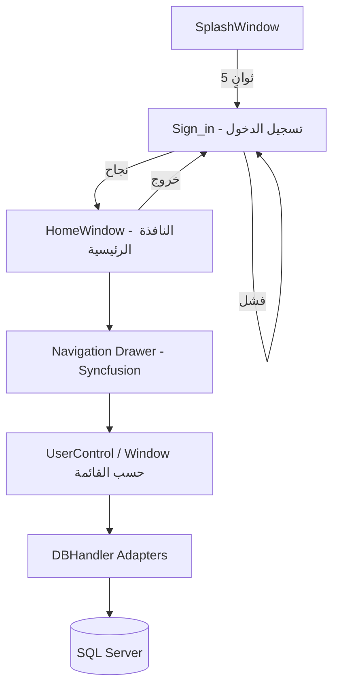
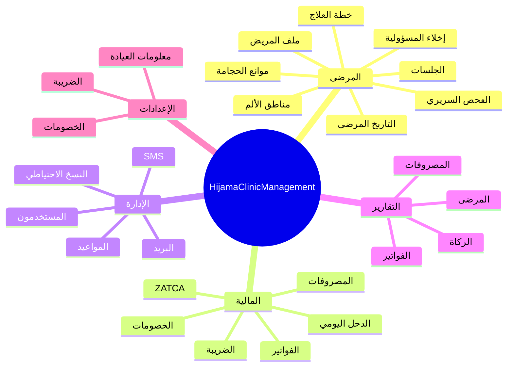

# توصيف تقني شامل — نظام إدارة عيادة الحجامة (HijamaClinicManagement)

> **المصدر:** تحليل كامل لكود المشروع، ملفات الإعداد، الحزم، والبنية المعمارية.  
> **تاريخ التوثيق:** 24 أغسطس 2026  
> **الإصدار:** 1.0.0.0  
> **حقوق النشر:** Copyright © 2021 — تطوير **فاست ميديا (FastMedia)**  
> **مرجع قاعدة البيانات:** [`توصيف_قاعدة_البيانات.md`](توصيف_قاعدة_البيانات.md)

---

## 1. نظرة عامة

**HijamaClinicManagement** هو تطبيق **سطح مكتب (Desktop)** مخصص لإدارة عيادات الحجامة في المملكة العربية السعودية. يغطي دورة العمل الكاملة في العيادة: من تسجيل المرضى والجلسات الطبية، إلى الفوترة الإلكترونية المتوافقة مع **هيئة الزكاة والضريبة والجمارك (ZATCA)**، والتقارير المالية، والمواعيد، والرسائل النصية، والنسخ الاحتياطي.

| البند | القيمة |
|-------|--------|
| نوع التطبيق | WinExe — تطبيق Windows مستقل |
| Root Namespace | `HijamaClinicManagement` |
| Assembly Name | `HijamaClinicManagement` |
| Project GUID | `{00177D83-1AE7-4769-BAFE-B48EEE0DAE51}` |
| اللغة | C# |
| واجهة المستخدم | WPF (XAML) + WinForms (تكامل ZATCA) |
| قاعدة البيانات | Microsoft SQL Server — `HijamaCenterDb` |
| اتجاه الواجهة | RTL (عربي) |
| الخط الافتراضي | Almarai |

---

## 2. الهدف والفئة المستهدفة

### 2.1 الهدف

توفير حل متكامل لعيادات الحجامة يُمكّن من:

- إدارة ملفات المرضى والجلسات العلاجية بشكل سريري منظم
- إصدار فواتير ضريبية متوافقة مع متطلبات الفوترة الإلكترونية السعودية
- متابعة الإيرادات والمصروفات وحساب الزكاة
- جدولة المواعيد وإرسال رسائل تذكير وتعليمات للمرضى
- إدارة حسابات الموظفين والصلاحيات
- استخراج تقارير PDF وExcel وRDLC

### 2.2 الفئة المستهدفة

- أطباء ومعالجو الحجامة
- موظفو الاستقبال والمحاسبة في العيادات
- مديرو العيادات (صلاحية Admin)

---

## 3. البنية المعمارية

### 3.1 النمط المعماري

التطبيق يتبع نمط **طبقات بسيط (Layered Architecture)** بدون فصل صارم (No MVVM):

```
┌─────────────────────────────────────────────────────────┐
│              Presentation Layer (WPF Views)             │
│  XAML + Code-Behind (.xaml.cs) — UserControl / Window   │
├─────────────────────────────────────────────────────────┤
│         Business Logic (مضمّن داخل Code-Behind)         │
│  حسابات الفواتير، الضريبة، الخصم، ZATCA، التحقق        │
├─────────────────────────────────────────────────────────┤
│              Data Access Layer (DBHandler)              │
│  Adapters — ADO.NET (SqlCommand / SqlDataReader)        │
│  Typed DataSets (TableAdapters) للتقارير فقط           │
├─────────────────────────────────────────────────────────┤
│              External Services / SDKs                   │
│  ZATCA SDK، Taqnyat SMS، SMTP Gmail، ReportViewer      │
├─────────────────────────────────────────────────────────┤
│              Microsoft SQL Server                       │
│              HijamaCenterDb (17 جدول)                   │
└─────────────────────────────────────────────────────────┘
```

### 3.2 تدفق تشغيل التطبيق



| المرحلة | الملف | الوصف |
|---------|-------|-------|
| بدء التشغيل | `App.xaml` → `StartupUri="SplashWindow.xaml"` | تسجيل ترخيص Syncfusion |
| شاشة التحميل | `SplashWindow.xaml.cs` | شريط تقدم 5 ثوانٍ ثم فتح تسجيل الدخول |
| المصادقة | `Sign in.xaml.cs` | التحقق من `Users` عبر `LoginAdapter` |
| الجلسة | `Sign_in.User` (static) | اسم المستخدم الحالي في كل الشاشات |
| الواجهة الرئيسية | `HomeWindow.xaml.cs` | قائمة جانبية + `BodyContent` Grid ديناميكي |

---

## 4. التقنيات والمكتبات المستخدمة

### 4.1 المنصة الأساسية

| التقنية | الإصدار | الاستخدام |
|---------|---------|-----------|
| .NET Framework | **4.8** | إطار التشغيل |
| C# | — | لغة البرمجة |
| WPF | — | واجهات XAML الرئيسية |
| Windows Forms | — | نوافذ ZATCA (`Zatca Bill/`) |
| ADO.NET | `System.Data.SqlClient` | الوصول للبيانات |
| Typed DataSet | XSD + TableAdapter | تقارير RDLC (Patient, Bill, Expenses) |

### 4.2 واجهة المستخدم والتصميم

| المكتبة | الإصدار | الاستخدام |
|---------|---------|-----------|
| **MaterialDesignThemes.Wpf** | 4.2.1 | ثيم Material Design Light |
| **MaterialDesignColors** | 2.0.3 | ألوان Material Design |
| **Syncfusion.SfNavigationDrawer.WPF** | 20.4.0.54 | القائمة الجانبية القابلة للطي |
| **Syncfusion.SfGrid.WPF** | 20.4.0.54 | جداول بيانات متقدمة |
| **Syncfusion.SfSkinManager.WPF** | 20.4.0.54 | إدارة السkins |
| **Syncfusion.Data.WPF** | 20.4.0.54 | ربط البيانات |
| **FontAwesome.WPF** | 4.7.0.9 | أيقونات (مرجع في المشروع) |
| خط **Almarai** | مضمّن | `Resources/Font/Almarai-Regular.ttf` |

**ألوان العلامة التجارية (من App.xaml):**

- أخضر التفاعل: `#76B82A` / `#61CE70`
- أزرار وأطر نص: `#FFABAdB3`

### 4.3 التقارير والمستندات

| المكتبة | الإصدار | الاستخدام |
|---------|---------|-----------|
| **Microsoft.ReportViewer.WinForms** | 10.0.0.0 | عرض تقارير RDLC (WindowsFormsHost) |
| **iTextSharp** | 5.5.13.3 | تصدير PDF (تقرير الزكاة وغيره) |
| **ClosedXML** | 0.95.4 | تصدير Excel |
| **DocumentFormat.OpenXml** | 2.7.2 | معالجة ملفات Office |
| ملفات RDLC | — | `Resources/BillsReport.rdlc`, `ExpencesReport.rdlc`, `PatientsReport.rdlc` |

### 4.4 الفوترة الإلكترونية (ZATCA)

| المكتبة / المكوّن | المصدر | الاستخدام |
|-------------------|--------|-----------|
| **ZatcaIntegrationSDK** | DLL خارجي | إنشاء، توقيع، وإرسال الفواتير الإلكترونية |
| **BouncyCastle.Crypto** | DLL | تشفير وتوقيع |
| **saxon-he-10.8** | DLL | معالجة XML/XSLT |
| **IKVM.\*** | DLL | تشغيل Java على .NET |
| **zxing** | DLL | QR Code (ZATCA Phase 2) |
| **QRCoder** | 1.7.0 | QR Code (Phase 1 — TLV Base64) |
| **Grpc.Core** | 2.46.5 | اتصالات gRPC (ZATCA SDK) |
| **Newtonsoft.Json** | 13.0.4 | JSON |

**أوضاع ZATCA المدعومة:**

- `Mode.Simulation` — محاكاة (افتراضي في `BillExtractWindow`)
- `Mode.Production` — فعلي
- `Mode.developer` — تطوير

**شهادات CSID:** تُقرأ من مجلد `cert/` (`cert.pem`, `key.pem`, `secret.txt`) عبر `MainSettings.GetCSIDInfo()`.

### 4.5 الاتصالات الخارجية

| الخدمة | المكتبة | الاستخدام |
|--------|---------|-----------|
| **Taqnyat.sa** | Taqnyat 1.0.11 | إرسال SMS جماعي وفردي |
| **Gmail SMTP** | `System.Net.Mail` | إرسال بريد (Port 587, SSL) |
| **FastMedia** | `Process.Start` + WebClient | روابط المساعدة والدعم |

### 4.6 حزم النظام الإضافية

| الحزمة | الإصدار |
|--------|---------|
| System.Memory | 4.5.3 |
| System.Buffers | 4.4.0 |
| System.Runtime.CompilerServices.Unsafe | 4.5.2 |
| System.IO.Packaging | 4.0.0 |
| ExcelNumberFormat | 1.0.10 |

---

## 5. هيكل المشروع (مجلدات المصدر)

```
HijamaClinicManagement/
├── App.xaml / App.xaml.cs          # نقطة الدخول + موارد عامة + Syncfusion License
├── SplashWindow.xaml(.cs)            # شاشة التحميل
├── Sign in.xaml(.cs)                 # تسجيل الدخول
├── HomeWindow.xaml(.cs)              # النافذة الرئيسية + التنقل
├── HomContentView.xaml(.cs)          # محتوى الصفحة الرئيسية (إحصائيات سريعة)
│
├── PatienViews/                      # إدارة المرضى والجلسات والفواتير
│   ├── PatientFileView               # ملف المريض (CRUD)
│   ├── ExtraSearchView             # بحث متقدم
│   ├── PatientsSessionView           # الجلسات (5 تبويبات سريرية)
│   ├── TreatmentPlanWindow           # خطة العلاج + نقاط الحجامة
│   ├── PainAreaWindow                # مناطق الألم
│   ├── BillExtractWindow             # إصدار فاتورة + ZATCA
│   ├── BillsMgView                   # إدارة الفواتير
│   ├── DeletedBillsMgView            # أرشيف الفواتير المحذوفة (Admin)
│   ├── PrintBill                     # طباعة الفاتورة
│   ├── PrintBillsMgView              # طباعة إدارة الفواتير
│   └── PrintPatientFileView          # طباعة ملف المريض
│
├── AppointmentsView/
│   ├── AppointmentsMg                # إدارة المواعيد (CRUD)
│   └── AppointmentsView              # عرض المواعيد
│
├── ClinicManagementViews/
│   ├── ExpensesView                  # المصروفات
│   ├── SendEmailView                 # إرسال بريد + مرفقات
│   └── BackupView                    # نسخ احتياطي SQL
│
├── ClinicSettingsViews/
│   ├── ClinicInfo                    # معلومات العيادة (واجهة فقط — غير مربوطة بـ DB)
│   ├── TaxSettings                   # إعدادات الضريبة
│   └── DiscountsSettings             # إعدادات الخصومات
│
├── ReportsViews/
│   ├── DailyIncom                    # الدخل اليومي (نقدي/شبكة)
│   ├── BillsReport                   # تقرير الفواتير (RDLC)
│   ├── ExpensesReport                # تقرير المصروفات
│   ├── PatientsReport                # تقرير المرضى
│   └── ZakatReport                   # تقرير الزكاة (PDF)
│
├── DashBoardView/
│   └── DashBoardView                 # لوحة تحكم إحصائية
│
├── UsersView/
│   ├── MyAccount                     # حسابي الشخصي
│   ├── MyNotes                       # ملاحظاتي
│   └── AccountsManagement            # إدارة الحسابات (Admin)
│
├── SMSView/
│   └── SMS                           # إرسال رسائل Taqnyat
│
├── MessageBoxRestyle/
│   ├── MessageBoxInformation         # عن الشركة
│   └── MessageBoxInformation2        # عن التطبيق
│
├── DBHandler/                        # طبقة الوصول للبيانات (22 ملف)
│   ├── ConnectionDB.cs
│   ├── PatientAdapter.cs
│   ├── SessionPhysicalAdaptercs.cs
│   ├── BillAdapter.cs
│   ├── ... (19 محولاً إضافياً)
│
├── Zatca Bill/                       # تكامل ZATCA (WinForms)
│   ├── SaudiZatca.cs                 # QR Phase 1 (TLV)
│   ├── MainSettings.cs               # CSID
│   ├── Form1.cs                      # واجهة اختبار ZATCA
│   ├── AutoGenerateCSR.cs            # توليد CSR
│   ├── RenewalCSID.cs                # تجديد CSID
│   ├── GeneratePDFA3.cs              # PDF/A-3
│   └── ...
│
├── Resources/
│   ├── Fonts.xaml
│   ├── Font/Almarai-Regular.ttf
│   ├── BillsReport.rdlc
│   ├── ExpencesReport.rdlc
│   └── PatientsReport.rdlc
│
├── Images/                           # أيقونات وخلفيات (~60+ ملف)
├── Properties/                       # AssemblyInfo, Settings, Resources
├── HijamaCenterDbDataSet*.xsd        # Typed DataSets (3)
├── App.config
├── packages.config
└── HijamaClinicManagement.csproj
```

---

## 6. الوحدات الوظيفية التفصيلية

### 6.1 إدارة المرضى (`PatienViews`)

| الشاشة | الوظيفة | الجداول |
|--------|---------|---------|
| **PatientFileView** | إنشاء/تعديل/حذف/بحث ملفات المرضى | `Patient` |
| **ExtraSearchView** | بحث متقدم بالاسم، الهوية، الجوال | `Patient` |
| **PatientsSessionView** | إدارة الجلسات — 5 أقسام: | `Session`, `PhysicalExamination`, `MedicalHistory`, `PastMedicalHistory`, `ContraindicationsOfCupping`, `DisclaimerForm` |
| **TreatmentPlanWindow** | خطة العلاج (أكواب جافة/دموية/متحركة/وامضة) + رسم نقاط على صورة الجسم | `TreatmentPlan` |
| **PainAreaWindow** | تحديد مناطق الألم على صورة الجسم + التشخيص | `PainAreas` |

**دورة البيانات السريرية:**

```
مريض جديد → Session → [MedicalHistory + PastMedicalHistory + Contraindications + PhysicalExamination]
         → TreatmentPlan + PainAreas → DisclaimerForm → Bill
```

### 6.2 الفواتير والضريبة

| الشاشة | الوظيفة |
|--------|---------|
| **BillExtractWindow** | حساب السعر، الضريبة (سعودي/غير سعودي)، الخصم، الدفع (نقدي/شبكة/مختلط)، حفظ في DB، إرسال لـ ZATCA |
| **BillsMgView** | عرض وتعديل وحذف الفواتير |
| **DeletedBillsMgView** | عرض الفواتير المؤرشفة (Admin فقط) |
| **PrintBill** | طباعة الفاتورة مع QR Code |

**منطق الفاتورة:**

- `SessionPrice` — السعر قبل الضريبة
- `Tax` / `TaxPercentage` — من جدول `Taxes` حسب الجنسية والتاريخ
- `Discount` — من جدول `Discounts` (نسبة، فترة، عدد جلسات)
- `PaymentType`: `نقدي` | `شبكة` | `نقدي وشبكة`
- عند الحذف: نسخ إلى `DeletedBillsRecords` ثم حذف من `Bill`

**تكامل ZATCA في BillExtractWindow:**

1. بناء XML فاتورة UBL 2.1
2. التوقيع الرقمي (BouncyCastle + CSID)
3. إرسال عبر ZatcaIntegrationSDK API
4. حفظ XML في `bin/Debug/Invoices/Normal/` و `Signed/`
5. توليد QR Code (Phase 1 TLV أو Phase 2 zxing)

### 6.3 المواعيد (`AppointmentsView`)

- **AppointmentsMg:** CRUD للمواعيد (اسم، جوال، تاريخ، وقت، نوع الغرفة)
- **AppointmentsView:** عرض تقويمي/جدولي
- **ملاحظة:** `PatientName` و `ContactNum` مُكرّران — لا FK مباشر مع `Patient`

### 6.4 الإدارة المالية

| الشاشة | الوظيفة | الجداول |
|--------|---------|---------|
| **ExpensesView** | تسجيل مصروفات العيادة | `Expenses` |
| **DailyIncom** | إجمالي الدخل اليومي (نقدي + شبكة) | `Bill` |
| **TaxSettings** | ضريبة السعوديين/غير السعوديين | `Taxes` |
| **DiscountsSettings** | قواعد الخصم | `Discounts` |

### 6.5 التقارير (`ReportsViews`)

| التقرير | التنسيق | المصدر |
|---------|---------|--------|
| تقرير المرضى | RDLC + Excel | `PatientsReport.rdlc`, `PatientAdapter` |
| تقرير الفواتير | RDLC | `BillsReport.rdlc`, `HijamaCenterDbDataSet1` |
| تقرير المصروفات | RDLC | `ExpencesReport.rdlc`, `HijamaCenterDbDataSet2` |
| تقرير الزكاة | PDF (iTextSharp) | `BillAdapter` — حساب 2.5% |
| الدخل اليومي | WPF UI | `BillAdapter.DailyBill_*` |

### 6.6 لوحة التحكم (`DashBoardView`)

إحصائيات يومية (تاريخ اليوم):

| المؤشر | الاستعلام |
|--------|-----------|
| ملفات جديدة | `COUNT(Patient WHERE FileDate = today)` |
| مواعيد اليوم | `COUNT(Appointments WHERE AppointmentDate = today)` |
| فواتير اليوم | `COUNT(Bill WHERE BillDate = today)` |
| فواتير محذوفة اليوم | `COUNT(DeletedBillsRecords WHERE DeleteBillDate = today)` |

### 6.7 المستخدمون والصلاحيات

| الدور | الصلاحيات |
|-------|-----------|
| **Admin** | كل الصلاحيات + إدارة الحسابات + الفواتير المحذوفة |
| **أدوار أخرى** | حسب قيمة `Role` في جدول `Users` — بدون إدارة حسابات أو فواتير محذوفة |

**آلية التحقق:** مقارنة `Sign_in.User.Equals("Admin")` في `HomeWindow.xaml.cs`.

| الشاشة | الوظيفة |
|--------|---------|
| **MyAccount** | تعديل اسم المستخدم، كلمة المرور، البريد، الصورة |
| **MyNotes** | ملاحظات شخصية + تذكير |
| **AccountsManagement** | CRUD للمستخدمين (Admin — يستثني مستخدم Admin من القائمة) |

### 6.8 الرسائل النصية (`SMSView`)

- **مزود الخدمة:** Taqnyat.sa
- **Bearer Token:** مُضمّن في `SmsAdapter.cs`
- **الوظائف:**
  - إرسال SMS فردي بعد طباعة ملف المريض (تعليمات ما بعد الحجامة)
  - بث جماعي لجميع أرقام `Patient.ContactNum`
  - التحقق من الرصيد (`GetBalance`)

### 6.9 البريد الإلكتروني (`SendEmailView`)

- **بروتوكول:** SMTP Gmail (Port 587, SSL)
- **الميزات:** موضوع، محتوى، مرفق ملف
- **متطلب:** تفعيل "Less secure app access" أو App Password

### 6.10 النسخ الاحتياطي (`BackupView`)

```sql
BACKUP DATABASE HijamaCenterDb TO DISK = '{path}\HijamaClinicDataBase-{timestamp}.bak'
```

- تنفيذ عبر `BackupDbAdapter.Create_BackupFile()`
- المستخدم يختار مسار الحفظ

### 6.11 إعدادات العيادة (`ClinicInfo`)

- **الحالة:** واجهة XAML موجودة لكن **أزرار CRUD فارغة** — لا يوجد Adapter أو جدول DB

---

## 7. طبقة الوصول للبيانات (DBHandler)

### 7.1 إدارة الاتصال

**`ConnectionDB.cs`** — Singleton بسيط:

```csharp
public static SqlConnection con;
// الاتصال الفعلي وقت التشغيل:
Data Source=DESKTOP-IA1BPMR;Initial Catalog=HijamaCenterDb;Integrated Security=True
```

**ملاحظة:** سلاسل اتصال متعددة في `App.config` لخوادم مختلفة، لكن الكود يستخدم اتصالاً **مُثبّتاً (Hardcoded)**.

### 7.2 المحولات (Adapters)

| المحول | الجدول/الوظيفة |
|--------|----------------|
| `ConnectionDB` | إدارة SqlConnection |
| `PatientAdapter` | Patient — CRUD + بحث |
| `SessionPhysicalAdaptercs` | Session + PhysicalExamination |
| `MedicalHistoryAdapter` | MedicalHistory |
| `PastMedicalHistoryAdapter` | PastMedicalHistory |
| `ContraindicationsOfCuppingAdapter` | ContraindicationsOfCupping |
| `TreatmentPlanAdapter` | TreatmentPlan |
| `PainAreasAdapter` | PainAreas |
| `DisclaimerFormAdapter` | DisclaimerForm |
| `BillAdapter` | Bill — CRUD + استعلامات يومية/تقارير |
| `DeletedBillsAdapter` | DeletedBillsRecords |
| `ExpenseAdapter` | Expenses |
| `AppointmentsAdapter` | Appointments |
| `UsersAdapter` | Users — CRUD |
| `LoginAdapter` | Users — مصادقة |
| `ForgetPasswordAdapter` | Users — استعادة كلمة المرور |
| `TaxAdapter` | Taxes |
| `DiscountsAdapter` | Discounts |
| `MyNotesAdapter` | MyNotes |
| `SmsAdapter` | Patient.ContactNum + Taqnyat API |
| `DashBoardAdapter` | إحصائيات COUNT |
| `BackupDbAdapter` | BACKUP DATABASE |

**نمط الاستعلام:** Parameterized SQL (`@Parameter`) عبر `SqlCommand` — بدون ORM، بدون Stored Procedures ظاهرة في الكود.

### 7.3 Typed DataSets

| الملف | الجدول | الاستخدام |
|-------|--------|-----------|
| `HijamaCenterDbDataSet.xsd` | Patient | TableAdapter |
| `HijamaCenterDbDataSet1.xsd` | Bill (نسخة قديمة 13 عمود) | تقرير RDLC |
| `HijamaCenterDbDataSet2.xsd` | Expenses | تقرير RDLC |

---

## 8. قاعدة البيانات

- **الاسم:** `HijamaCenterDb`
- **SGBD:** Microsoft SQL Server
- **المصادقة:** Windows Integrated Security
- **عدد الجداول:** 17
- **التوثيق التفصيلي:** راجع [`توصيف_قاعدة_البيانات.md`](توصيف_قاعدة_البيانات.md)

**الجداول الرئيسية:**

`Patient` → `Session` → [MedicalHistory, PastMedicalHistory, ContraindicationsOfCupping, PhysicalExamination, TreatmentPlan, PainAreas, DisclaimerForm, Bill]

**جداول مساندة:** `Users`, `Appointments`, `Expenses`, `Taxes`, `Discounts`, `MyNotes`, `DeletedBillsRecords`

---

## 9. التخزين المحلي للملفات

| المسار | المحتوى |
|--------|---------|
| `F:\HijamaAppImages\HijamaQrImages\` | صور QR Code للفواتير |
| `F:\HijamaAppImages\ImagesPainArea\` | صور نقاط الألم `{FileNum}{SessionId}.png` |
| `C:\HijamaAppImages\ImagesTreatmentPlan\` | صور نقاط الحجامة |
| `{CurrentDirectory}\cert\` | شهادات ZATCA (cert.pem, key.pem, secret.txt) |
| `{CurrentDirectory}\Invoices\Normal\` | XML فواتير غير موقّعة |
| `{CurrentDirectory}\Invoices\Signed\` | XML فواتير موقّعة |
| `{Desktop}\تقارير الزكاة والدخل\` | PDF تقارير الزكاة |

---

## 10. الأمان والمصادقة

| الجانب | التفاصيل |
|--------|----------|
| تسجيل الدخول | `Users.UserName` + `Users.Password` |
| مقارنة كلمة المرور | `COLLATE SQL_Latin1_General_CP1_CS_AS` (حساسة لحالة الأحرف) |
| تخزين كلمة المرور | **نص صريح (Plain Text)** — بدون Hashing |
| الجلسة | متغير static `Sign_in.User` — بدون Token أو Session ID |
| الصلاحيات | فحص اسم المستخدم `"Admin"` برمجياً |
| API Keys | Bearer Token Taqnyat مُضمّن في الكود |
| CSID ZATCA | ملفات PEM في مجلد `cert/` |
| Syncfusion License | مُضمّن في `App.xaml.cs` |

---

## 11. واجهة المستخدم — تفاصيل تقنية

### 11.1 النافذة الرئيسية (HomeWindow)

- **Syncfusion SfNavigationDrawer** — قائمة جانبية قابلة للطي (Compact / Expanded)
- **BodyContent** — `Grid` ثابت (`public static Grid mainbodycontent`) يُحمّل فيه UserControls ديناميكياً
- **نافذة بدون إطار (Borderless)** — سحب عبر `DragMove()`، أزرار إغلاق/تصغير/تكبير مخصصة
- **الصفحة الرئيسية:** إحصائيات + جداول مرضى/مواعيد/مستخدمين + أزرار سريعة (مريض جديد، جلسة، موعد)

### 11.2 أنماط مخصصة (App.xaml)

- `ButtonStyle` — زوايا دائرية 5px، hover أخضر
- `TextBoxStyle` — border أخضر عند hover
- `DataGridStyle` — خط Almarai، border `#D0D0D0`
- `ShowHidePassCheckBoxStyle` — إظهار/إخفاء كلمة المرور

### 11.3 MessageBox مخصص

- `MessageBoxInformation` — معلومات عن فاست ميديا
- `MessageBoxInformation2` — معلومات عن التطبيق

---

## 12. التكامل مع ZATCA — تفاصيل تقنية

### 12.1 الملفات المعنية

| الملف | الدور |
|-------|-------|
| `PatienViews/BillExtractWindow.xaml.cs` | نقطة الإصدار الرئيسية من WPF |
| `Zatca Bill/SaudiZatca.cs` | TLV encoding + QR Phase 1 |
| `Zatca Bill/MainSettings.cs` | قراءة CSID |
| `Zatca Bill/AutoGenerateCSR.cs` | Certificate Signing Request |
| `Zatca Bill/RenewalCSID.cs` | تجديد الشهادة |
| `Zatca Bill/GeneratePDFA3.cs` | تحويل XML إلى PDF/A-3 |
| `Zatca Bill/Form1.cs` | واجهة WinForms للاختبار |

### 12.2 تنسيق QR Code (Phase 1)

```
Tag 1: Seller Name
Tag 2: VAT Registration
Tag 3: Timestamp
Tag 4: Invoice Amount
Tag 5: VAT Amount
→ TLV → Base64 → QRCoder
```

### 12.3 أوضاع التشغيل

| الوضع | الاستخدام |
|-------|-----------|
| Simulation | اختبار — صلاحية سنتان |
| Production | إنتاج — صلاحية 5 سنوات |
| developer | تطوير محلي |

---

## 13. البناء والنشر

### 13.1 إعدادات MSBuild

| الإعداد | Debug | Release |
|---------|-------|---------|
| OutputPath | `bin\Debug\` | `bin\Release\` |
| PlatformTarget | AnyCPU | AnyCPU |
| Optimize | false | true |
| DefineConstants | DEBUG;TRACE | TRACE |

### 13.2 المتطلبات

| المتطلب | التفاصيل |
|---------|----------|
| نظام التشغيل | Windows 7+ (WPF 4.8) |
| .NET Framework | 4.8 |
| SQL Server | Express أو أعلى — قاعدة `HijamaCenterDb` |
| Visual Studio | 2017+ (ToolsVersion 15.0) |
| NuGet Restore | مطلوب قبل البناء |
| Syncfusion License | مُضمّن في الكود |
| ZATCA DLLs | مسارات خارجية في `.csproj` — قد تحتاج تعديل |

### 13.3 ملفات الإخراج

- `HijamaClinicManagement.exe`
- `HijamaClinicManagement.exe.config`
- DLLs (NuGet + ZATCA)
- `Resources/*.rdlc`
- `cert/` (شهادات ZATCA)

---

## 14. الروابط والدعم (FastMedia)

| الرابط | الغرض |
|--------|-------|
| https://www.fastmedia.one/ar/application-of-cupping-clinic/ | توثيق التطبيق |
| https://www.youtube.com/channel/UCoDJRPwahDaV2ts1CiAQZqA | فيديوهات تعليمية |
| https://www.fastmedia.one/ar/contact/ | الدعم الفني |

---

## 15. القيود والملاحظات التقنية المعروفة

| # | القيد |
|---|-------|
| 1 | اتصال DB **Hardcoded** في `ConnectionDB.cs` — يحتاج تعديل يدوي عند النشر |
| 2 | كلمات المرور **Plain Text** — مخاطرة أمنية |
| 3 | لا يوجد MVVM — منطق الأعمال مدمج في Code-Behind |
| 4 | `ClinicInfo` غير مفعّل — لا DB Adapter |
| 5 | `ForgetPassword` معطّل في واجهة تسجيل الدخول |
| 6 | مسارات الصور **Hardcoded** (`F:\`, `C:\`) |
| 7 | Taqnyat Bearer Token **مكشوف** في الكود |
| 8 | Typed DataSet لـ Bill **قديم** (13 عمود) vs BillAdapter (19 عمود) |
| 9 | لا Foreign Keys ظاهرة — الربط برمجي فقط |
| 10 | ZATCA DLLs تشير لمسارات Downloads — قد لا تبنى على جهاز جديد |
| 11 | صلاحيات Admin مبنية على اسم المستخدم `"Admin"` وليس حقل `Role` |
| 12 | جلسة المستخدم static — لا timeout |

---

## 16. ملخص إحصائي للمشروع

| البند | العدد |
|-------|-------|
| نوافذ WPF (Window) | ~8 |
| UserControls | ~25 |
| WinForms (ZATCA) | ~6 |
| DBHandler Adapters | 22 |
| جداول قاعدة البيانات | 17 |
| Typed DataSets | 3 |
| تقارير RDLC | 3 |
| حزم NuGet | ~25 |
| DLLs خارجية (ZATCA) | ~10 |
| صور/أيقونات | ~60+ |

---

## 17. مخطط الوحدات الوظيفية



---

## 18. المراجع داخل المشروع

| الملف/المجلد | المحتوى |
|--------------|---------|
| `HijamaClinicManagement.csproj` | تعريف المشروع والمراجع |
| `packages.config` | حزم NuGet |
| `App.config` | سلاسل الاتصال + Binding Redirects |
| `DBHandler/` | طبقة البيانات |
| `Zatca Bill/` | تكامل الفوترة الإلكترونية |
| `Resources/*.rdlc` | قوالب التقارير |
| `توصيف_قاعدة_البيانات.md` | توثيق DB التفصيلي |

---

*هذا التوصيف مُستخرج من تحليل كامل لكود المشروع المصدر. للتحقق من البنية الفعلية لقاعدة البيانات على SQL Server، راجع [`توصيف_قاعدة_البيانات.md`](توصيف_قاعدة_البيانات.md).*
