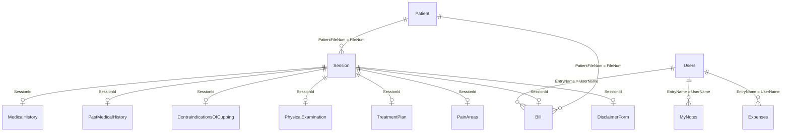

# توصيف قاعدة بيانات نظام إدارة عيادة الحجامة (HijamaCenterDb)

> **المصدر:** استخراج من كود المشروع (مجلد `DBHandler`، ملفات Typed DataSet `*.xsd`، وملفات الإعدادات).  
> **تاريخ التوثيق:** 30 يونيو 2026  
> **اسم قاعدة البيانات:** `HijamaCenterDb`  
> **نظام إدارة قواعد البيانات:** Microsoft SQL Server  
> **طريقة الاتصال:** Windows Integrated Security (مصادقة ويندوز)

---

## 1. نظرة عامة

قاعدة البيانات `HijamaCenterDb` هي القلب التخزيني لتطبيق **إدارة عيادة الحجامة** (WPF / C#). تغطي دورة العمل الكاملة في العيادة:

- تسجيل المرضى وملفاتهم
- إدارة الجلسات الطبية والفحص البدني
- التاريخ المرضي وموانع الحجامة وخطط العلاج
- الفواتير والمصروفات والضرائب والخصومات
- المواعيد والمستخدمين والملاحظات الشخصية
- أرشفة الفواتير المحذوفة

تحتوي القاعدة على **17 جدولاً** فعلياً. لا توجد في المشروع سكربتات `CREATE TABLE`؛ وتم استنتاج البنية من استعلامات SQL في طبقة الوصول للبيانات.

---

## 2. إعدادات الاتصال

| المصدر | الوصف |
|--------|--------|
| `App.config` / `Settings.settings` | ثلاث سلاسل اتصال بأسماء مختلفة (`HijamaCenterDbConnectionString`، `...1`، `...2`) تشير إلى خوادم SQL مختلفة لنفس قاعدة `HijamaCenterDb` |
| `DBHandler/ConnectionDB.cs` | الاتصال الفعلي وقت التشغيل **مُثبّت في الكود** على: `Data Source=DESKTOP-IA1BPMR;Initial Catalog=HijamaCenterDb;Integrated Security=True` |

**ملاحظة:** Typed DataSets تستخدم `System.Data.SqlClient` وتتصل عبر إعدادات `Settings.settings`.

---

## 3. مخطط العلاقات بين الجداول

العلاقات أدناه **منطقية** (مستنتجة من أسماء الأعمدة واستعلامات JOIN)، ولا تظهر في الكود قيود `FOREIGN KEY` صريحة على مستوى SQL Server.



**الجدول المحوري:** `Patient` — كل البيانات السريرية والمالية مرتبطة برقم الملف `FileNum`.

**الجدول الثانوي:** `Session` — كل سجل طبي/علاجي/فاتورة مرتبط بجلسة واحدة عبر `SessionId`.

---

## 4. جداول غير موجودة (مهم)

| الاسم المتوقع | الواقع في المشروع |
|---------------|-------------------|
| Login | لا يوجد جدول — تسجيل الدخول يقرأ من جدول `Users` |
| SMS | لا يوجد جدول — الرسائل النصية تقرأ أرقام الهاتف من `Patient.ContactNum` |
| ClinicInfo | واجهة إعدادات موجودة لكن **لا يوجد جدول أو استعلام SQL** في الكود |

---

## 5. توصيف الجداول التفصيلي

### 5.1 جدول Patient — المرضى

**الوظيفة:** تخزين البيانات الديموغرافية وبيانات الاتصال لكل مريض.

**المفتاح الأساسي:** `FileNum` (INT، تزايد تلقائي IDENTITY)

| العمود | النوع | إلزامي | الطول الأقصى | الوصف بالعربية |
|--------|------|--------|--------------|----------------|
| FileNum | INT | نعم | — | رقم ملف المريض (مفتاح أساسي) |
| PatientName | VARCHAR | نعم | 50 | اسم المريض |
| FileDate | DATE | نعم | — | تاريخ فتح الملف |
| NationalNum | VARCHAR | لا | 10 | رقم الهوية الوطنية |
| ContactNum | VARCHAR | نعم | 15 | رقم الجوال |
| Age | INT | لا | — | العمر |
| Gender | VARCHAR | لا | 6 | الجنس |
| MaritalStatus | VARCHAR | لا | 8 | الحالة الاجتماعية |
| Address | VARCHAR | لا | 50 | العنوان |
| Job | VARCHAR | لا | 10 | المهنة |
| JobAddress | VARCHAR | لا | 50 | عنوان العمل |
| Email | VARCHAR | لا | 50 | البريد الإلكتروني |
| PnameForEmergency | VARCHAR | لا | 30 | اسم شخص للطوارئ |
| ContactNumForEmergency | VARCHAR | لا | 15 | رقم اتصال الطوارئ |

**ملفات المصدر:** `PatientAdapter.cs`، `HijamaCenterDbDataSet.xsd`

---

### 5.2 جدول Session — الجلسات

**الوظيفة:** تسجيل كل جلسة حجامة/علاجية للمريض.

**المفتاح الأساسي:** `SessionId` (INT، IDENTITY)

| العمود | النوع | إلزامي | الوصف بالعربية |
|--------|------|--------|----------------|
| SessionId | INT | نعم | معرف الجلسة (مفتاح أساسي) |
| SessionNum | INT | نعم | رقم الجلسة التسلسلي للمريض (1، 2، 3...) |
| SessionDate | DATE | نعم | تاريخ الجلسة |
| CurrentCopmlaints | VARCHAR | لا | الشكاوى الحالية *(اسم العمود في DB به خطأ إملائي: Copmlaints)* |
| Complications | VARCHAR | لا | المضاعفات |
| SessionDuration | VARCHAR | لا | مدة الجلسة |
| PatientFileNum | INT | نعم | رقم ملف المريض → `Patient.FileNum` |

**ملف المصدر:** `SessionPhysicalAdaptercs.cs`

---

### 5.3 جدول PhysicalExamination — الفحص البدني

**الوظيفة:** تسجيل العلامات الحيوية والفحص السريري لكل جلسة.

**المفتاح الأساسي:** `PhysicalExaminationId` (INT، IDENTITY)

| العمود | النوع | إلزامي | الوصف بالعربية |
|--------|------|--------|----------------|
| PhysicalExaminationId | INT | نعم | معرف الفحص |
| Temp | FLOAT | لا | درجة الحرارة |
| Hr | INT | لا | معدل ضربات القلب |
| Rr | INT | لا | معدل التنفس |
| Bp | VARCHAR | لا | ضغط الدم (مثل 120/80) |
| HeadAndNeck | VARCHAR | لا | الرأس والرقبة |
| ChestAndBack | VARCHAR | لا | الصدر والظهر |
| Abdomen | VARCHAR | لا | البطن |
| Pelvis | VARCHAR | لا | الحوض |
| UpperAndLowerLimbs | VARCHAR | لا | الأطراف العلوية والسفلية |
| Others | VARCHAR | لا | ملاحظات أخرى |
| PatientFileNum | INT | نعم | → `Patient.FileNum` |
| SessionId | INT | نعم | → `Session.SessionId` |

**ملف المصدر:** `SessionPhysicalAdaptercs.cs`

---

### 5.4 جدول Bill — الفواتير

**الوظيفة:** تسجيل فواتير الجلسات مع تفاصيل الدفع والضريبة والخصم.

**المفتاح الأساسي:** `BillId` (INT، IDENTITY)

| العمود | النوع | إلزامي | الطول | الوصف بالعربية |
|--------|------|--------|-------|----------------|
| BillId | INT | نعم | — | رقم الفاتورة |
| BillDate | DATE | نعم | — | تاريخ الفاتورة |
| PaymentChipType | INT | نعم | — | نوع الدفع بالشبكة (0/1) |
| AdditionalServices | VARCHAR | لا | 50 | خدمات إضافية |
| PriceOfAdditionalServices | FLOAT | لا | — | سعر الخدمات الإضافية |
| Nationality | VARCHAR | نعم | 10 | الجنسية (`سعودي` / `غير سعودي`) |
| Tax | FLOAT | لا | — | قيمة الضريبة بالريال |
| TaxPercentage | VARCHAR | لا | — | نسبة الضريبة *(أُضيف لاحقاً — غير موجود في XSD القديم)* |
| Discount | FLOAT | لا | — | قيمة الخصم |
| PaymentType | VARCHAR | نعم | 20 | طريقة الدفع (`نقدي`، `شبكة`، `نقدي وشبكة`) |
| SessionPrice | FLOAT | نعم | — | سعر الجلسة *(أُضيف لاحقاً)* |
| TotalPricePaid | FLOAT | نعم | — | إجمالي المبلغ |
| PaidCash | FLOAT | لا | — | المبلغ المدفوع نقداً *(أُضيف لاحقاً)* |
| PaidNetwork | FLOAT | لا | — | المبلغ المدفوع شبكة *(أُضيف لاحقاً)* |
| FinallyPaidAmount | FLOAT | نعم | — | المبلغ النهائي المدفوع *(أُضيف لاحقاً)* |
| PaidValue | FLOAT | نعم | — | قيمة المدفوع *(أُضيف لاحقاً)* |
| AmountRemainingUnpaid | FLOAT | نعم | — | المبلغ المتبقي غير المدفوع |
| EntryName | VARCHAR | نعم | 50 | اسم المستخدم الذي أدخل الفاتورة → `Users.UserName` |
| PatientFileNum | INT | نعم | — | → `Patient.FileNum` |
| SessionId | INT | نعم | — | → `Session.SessionId` |

**ملاحظة:** ملف `HijamaCenterDbDataSet1.xsd` يعكس نسخة أقدم من الجدول (13 عموداً فقط). الكود الحالي في `BillAdapter.cs` يستخدم 19 عموداً.

**ملف المصدر:** `BillAdapter.cs`

---

### 5.5 جدول DeletedBillsRecords — أرشيف الفواتير المحذوفة

**الوظيفة:** حفظ نسخة من الفاتورة قبل حذفها من جدول `Bill`.

**المفتاح الأساسي:** `DeletedBillRecId` (INT، IDENTITY)

| العمود | النوع | إلزامي | الوصف بالعربية |
|--------|------|--------|----------------|
| DeletedBillRecId | INT | نعم | معرف سجل الأرشيف |
| PatientFileNum | INT | نعم | رقم ملف المريض |
| BillId | INT | نعم | رقم الفاتورة الأصلي |
| BillDate | DATE | نعم | تاريخ الفاتورة |
| PaymentChipType | INT | نعم | نوع الدفع بالشبكة |
| AdditionalServices | VARCHAR | لا | خدمات إضافية |
| PriceOfAdditionalServices | FLOAT | لا | سعر الخدمات الإضافية |
| Nationality | VARCHAR | نعم | الجنسية |
| Tax | VARCHAR/FLOAT | لا | الضريبة *(يُخزَّن كنص في مسار الإدراج)* |
| Discount | FLOAT | لا | الخصم |
| PaymentType | VARCHAR | نعم | طريقة الدفع |
| TotalPricePaid | FLOAT | نعم | إجمالي المبلغ |
| AmountRemainingUnpaid | FLOAT | نعم | المبلغ المتبقي |
| EntryName | VARCHAR | نعم | اسم المستخدم |
| DeleteBillDate | DATE | نعم | تاريخ حذف/أرشفة الفاتورة |

**ملف المصدر:** `DeletedBillsAdapter.cs`

---

### 5.6 جدول Expenses — المصروفات

**الوظيفة:** تسجيل مصروفات العيادة التشغيلية.

**المفتاح الأساسي:** `ExpenseId` (INT، IDENTITY)

| العمود | النوع | إلزامي | الطول | الوصف بالعربية |
|--------|------|--------|-------|----------------|
| ExpenseId | INT | نعم | — | معرف المصروف |
| ExpenseBillNum | VARCHAR | لا | 50 | رقم فاتورة المصروف |
| ExpenseName | VARCHAR | نعم | 50 | اسم/وصف المصروف |
| ExpenseDate | DATE | نعم | — | تاريخ المصروف |
| Amount | FLOAT | لا | — | المبلغ قبل الضريبة |
| Tax | FLOAT | لا | — | الضريبة |
| TotalPricePaid | FLOAT | نعم | — | الإجمالي المدفوع |
| EntryName | VARCHAR | نعم | 50 | اسم المستخدم المُدخل |

**ملفات المصدر:** `ExpenseAdapter.cs`، `HijamaCenterDbDataSet2.xsd`

---

### 5.7 جدول Users — المستخدمون

**الوظيفة:** حسابات موظفي العيادة وصلاحياتهم.

**المفتاح الأساسي:** `UserId` (INT، IDENTITY)

| العمود | النوع | إلزامي | الوصف بالعربية |
|--------|------|--------|----------------|
| UserId | INT | نعم | معرف المستخدم |
| UserName | VARCHAR | نعم | اسم المستخدم (للدخول) |
| Password | VARCHAR | نعم | كلمة المرور *(مقارنة حساسة لحالة الأحرف)* |
| Role | VARCHAR | نعم | الدور/الصلاحية |
| PersonalImg | VARCHAR | لا | مسار صورة الملف الشخصي |
| Email | VARCHAR | نعم | البريد الإلكتروني |

**ملفات المصدر:** `UsersAdapter.cs`، `LoginAdapter.cs`، `ForgetPasswordAdapter.cs`

---

### 5.8 جدول Appointments — المواعيد

**الوظيفة:** جدولة مواعيد المرضى.

**المفتاح الأساسي:** `AppointmentId` (INT، IDENTITY)

| العمود | النوع | إلزامي | الوصف بالعربية |
|--------|------|--------|----------------|
| AppointmentId | INT | نعم | معرف الموعد |
| ContactNum | VARCHAR | نعم | رقم الجوال *(مرتبط منطقياً بـ Patient.ContactNum)* |
| PatientName | VARCHAR | نعم | اسم المريض *(مُكرَّر — غير مرتبط بجدول Patient)* |
| AppointmentDate | DATE | نعم | تاريخ الموعد |
| AppointmentTime | DATETIME | نعم | وقت الموعد |
| RoomType | VARCHAR | لا | نوع الغرفة/الخدمة |
| OtherNote | VARCHAR | لا | ملاحظات *(يُدرج دائماً NULL من المحول)* |

**ملف المصدر:** `AppointmentsAdapter.cs`

---

### 5.9 جدول MedicalHistory — التاريخ المرضي للجلسة

**الوظيفة:** تفاصيل الشكوى والألم والأدوية لكل جلسة.

**المفتاح الأساسي:** `MedicalHistoryId` (INT، IDENTITY)

| العمود | النوع | إلزامي | الوصف بالعربية |
|--------|------|--------|----------------|
| MedicalHistoryId | INT | نعم | المعرف |
| MainSymptoms | VARCHAR | لا | الأعراض الرئيسية |
| OnsetOfPain | VARCHAR | لا | بداية الألم |
| LocationOfPain | VARCHAR | لا | موقع الألم |
| DurationOfPain | VARCHAR | لا | مدة الألم |
| CharacterOfPain | VARCHAR | لا | طبيعة الألم |
| AggravatingAndRelievingFactorsOnPain | VARCHAR | لا | عوامل تفاقم/تخفيف الألم |
| Timing | VARCHAR | لا | التوقيت |
| Severity | VARCHAR | لا | شدة الألم |
| Allergies | VARCHAR | لا | الحساسية |
| Medications | VARCHAR | لا | الأدوية |
| PastSurgicalOrCuppingHistory | VARCHAR | لا | تاريخ جراحي/حجامة سابق |
| AnotherComplaints | VARCHAR | لا | شكاوى أخرى |
| ConsultationWithDoctor | VARCHAR | لا | استشارة طبيب |
| PatienFileNum | INT | نعم | رقم ملف المريض *(اسم العمود في DB: Patien — بدون t)* → `Patient.FileNum` |
| SessionId | INT | نعم | → `Session.SessionId` |

**ملف المصدر:** `MedicalHistoryAdapter.cs`

---

### 5.10 جدول PastMedicalHistory — التاريخ المرضي السابق

**الوظيفة:** قائمة الأمراض والحالات السابقة (checkboxes) لكل جلسة.

**المفتاح الأساسي:** `PastMedicalHistoryId` (INT، IDENTITY)

| العمود | النوع | إلزامي | الوصف بالعربية |
|--------|------|--------|----------------|
| PastMedicalHistoryId | INT | نعم | المعرف |
| BleedingDisorders | VARCHAR | لا | اضطرابات نزف |
| Hypertension | VARCHAR | لا | ارتفاع ضغط الدم |
| CardiacDiseases | VARCHAR | لا | أمراض قلب |
| Diabetes | VARCHAR | لا | السكري |
| HepAtitis | VARCHAR | لا | التهاب الكبد |
| Aids | VARCHAR | لا | الإيدز |
| Cva | VARCHAR | لا | جلطة/سكتة |
| Tb | VARCHAR | لا | السل |
| Epilepsy | VARCHAR | لا | الصرع |
| KidneyDiseases | VARCHAR | لا | أمراض الكلى |
| PsychiatricDiseases | VARCHAR | لا | أمراض نفسية |
| Cancer | VARCHAR | لا | السرطان |
| Anemia | VARCHAR | لا | فقر الدم |
| Smoking | VARCHAR | لا | التدخين |
| Others | VARCHAR | لا | أخرى |
| PatientFileNum | INT | نعم | → `Patient.FileNum` |
| SessionId | INT | نعم | → `Session.SessionId` |

**ملف المصدر:** `PastMedicalHistoryAdapter.cs`

---

### 5.11 جدول ContraindicationsOfCupping — موانع الحجامة

**الوظيفة:** تسجيل موانع الحجامة لكل جلسة.

**المفتاح الأساسي:** `ContraindicationId` (INT، IDENTITY)

| العمود | النوع | إلزامي | الوصف بالعربية |
|--------|------|--------|----------------|
| ContraindicationId | INT | نعم | المعرف |
| Diabetes | VARCHAR | لا | السكري |
| RenalFailure | VARCHAR | لا | فشل كلوي |
| BleedingDisordersAndAnticoagulants | VARCHAR | لا | اضطرابات نزف ومميعات |
| Aids | VARCHAR | لا | الإيدز |
| LiverFailureOrHepAtitis | VARCHAR | لا | فشل كبد/التهاب كبد |
| Pregnancy | VARCHAR | لا | الحمل |
| ChildrenBelow12Years | VARCHAR | لا | أطفال دون 12 سنة |
| Pacemaker | VARCHAR | لا | منظم ضربات القلب |
| VaricoseVeins | VARCHAR | لا | دوالي |
| ChemoOrCancer | VARCHAR | لا | كيماوي/سرطان *(INSERT يستخدم `@ChemoRadiotherapyOrCancer`)* |
| PatientFileNum | INT | نعم | → `Patient.FileNum` |
| SessionId | INT | نعم | → `Session.SessionId` |

**ملف المصدر:** `ContraindicationsOfCuppingAdapter.cs`

---

### 5.12 جدول TreatmentPlan — خطة العلاج

**الوظيفة:** خطة الحجامة المقترحة لكل جلسة.

**المفتاح الأساسي:** `TreatmentPlanId` (INT، IDENTITY)

| العمود | النوع | إلزامي | الوصف بالعربية |
|--------|------|--------|----------------|
| TreatmentPlanId | INT | نعم | المعرف |
| Date | DATE | نعم | تاريخ الخطة |
| NumberOfSuggestedVisits | INT | لا | عدد الزيارات المقترحة |
| DryCupping | INT | لا | عدد أكواب جافة |
| BloodyCupping | INT | لا | عدد أكواب دموية |
| SlidingCupping | INT | لا | عدد أكواب متحركة |
| FlashingCupping | INT | لا | عدد أكواب وامضة |
| DurationBetweenCupping | VARCHAR | لا | المدة بين الجلسات |
| DateOfNextVisit | DATE | لا | تاريخ الزيارة القادمة |
| CuppingPointsInSession | VARCHAR | لا | مسار صورة نقاط الحجامة |
| PatientFileNum | INT | نعم | → `Patient.FileNum` |
| SessionId | INT | نعم | → `Session.SessionId` |

**ملف المصدر:** `TreatmentPlanAdapter.cs`

---

### 5.13 جدول PainAreas — مناطق الألم

**الوظيفة:** تسجيل نقاط الألم والتشخيص لكل جلسة.

**المفتاح الأساسي:** `PainAreaId` (INT، IDENTITY)

| العمود | النوع | إلزامي | الوصف بالعربية |
|--------|------|--------|----------------|
| PainAreaId | INT | نعم | المعرف |
| PainPoints | VARCHAR | لا | مسار صورة نقاط الألم |
| PainSeverity | INT | لا | شدة الألم |
| Diagnosis | VARCHAR | لا | التشخيص |
| PatientFileNum | INT | نعم | → `Patient.FileNum` |
| SessionId | INT | نعم | → `Session.SessionId` |

**ملف المصدر:** `PainAreasAdapter.cs`

---

### 5.14 جدول DisclaimerForm — نموذج إخلاء المسؤولية

**الوظيفة:** حفظ صورة/نسخة مطبوعة من نموذج إخلاء المسؤولية.

**المفتاح الأساسي:** `DisclaimerFormId` (INT، IDENTITY)

| العمود | النوع | إلزامي | الوصف بالعربية |
|--------|------|--------|----------------|
| DisclaimerFormId | INT | نعم | المعرف |
| PrintImg | VARCHAR | نعم | مسار/بيانات الصورة المطبوعة |
| PatientFileNum | INT | نعم* | → `Patient.FileNum` |
| SessionId | INT | نعم* | → `Session.SessionId` |

\* موجود في SELECT/UPDATE لكن **غير مُدرَج في INSERT** (`Insert Into DisclaimerForm Values (@PrintImg)`) — قد يعتمد على قيم افتراضية أو trigger في DB.

**ملف المصدر:** `DisclaimerFormAdapter.cs`

---

### 5.15 جدول Taxes — إعدادات الضريبة

**الوظيفة:** تخزين نسب/قيم الضريبة للسعوديين وغير السعوديين حسب التاريخ.

**المفتاح الأساسي:** `TaxId` (INT، IDENTITY)

| العمود | النوع | إلزامي | الوصف بالعربية |
|--------|------|--------|----------------|
| TaxId | INT | نعم | المعرف |
| Date | DATE | نعم | تاريخ سريان الضريبة |
| TaxForNonSaudis | VARCHAR | لا | ضريبة غير السعوديين |
| TaxForSaudis | VARCHAR | لا | ضريبة السعوديين |

**ملف المصدر:** `TaxAdapter.cs`

---

### 5.16 جدول Discounts — الخصومات

**الوظيفة:** تعريف قواعد الخصم (نسبة، فترة زمنية، عدد جلسات، شخص محدد).

**المفتاح الأساسي:** `Discount_Id` (INT، IDENTITY)

| العمود | النوع | إلزامي | الوصف بالعربية |
|--------|------|--------|----------------|
| Discount_Id | INT | نعم | المعرف |
| DiscountDate | DATE | نعم | تاريخ الخصم |
| DiscountRate | FLOAT | نعم | نسبة/قيمة الخصم |
| StartTime | DATETIME | لا | وقت بداية الخصم |
| EndTime | DATETIME | لا | وقت نهاية الخصم |
| TotalPricePaid | FLOAT | لا | إجمالي السعر المطلوب للاستحقاق |
| NumOfSessions | INT | لا | عدد الجلسات المطلوب |
| SpeceficPerson | INT | نعم | علامة شخص محدد (0/1) |

**ملف المصدر:** `DiscountsAdapter.cs`

---

### 5.17 جدول MyNotes — الملاحظات الشخصية

**الوظيفة:** ملاحظات وتذكيرات خاصة بكل مستخدم.

**المفتاح الأساسي:** `MyNoteId` (INT، IDENTITY)

| العمود | النوع | إلزامي | الوصف بالعربية |
|--------|------|--------|----------------|
| MyNoteId | INT | نعم | المعرف |
| MyNoteName | VARCHAR | نعم | عنوان الملاحظة |
| MyNoteContent | VARCHAR | نعم | محتوى الملاحظة |
| MyNoteDate | DATE | نعم | تاريخ الإنشاء |
| EntryName | VARCHAR | نعم | اسم المستخدم → `Users.UserName` |
| RemindMe | DATE | لا | تاريخ التذكير |

**ملف المصدر:** `MyNotesAdapter.cs`

---

## 6. ربط الجداول بوحدات التطبيق

| وحدة التطبيق | الجداول المستخدمة |
|--------------|-------------------|
| ملف المريض / البحث | Patient، Session، MedicalHistory، PastMedicalHistory، ContraindicationsOfCupping، PhysicalExamination، TreatmentPlan، PainAreas، DisclaimerForm |
| الفواتير | Bill، DeletedBillsRecords |
| المصروفات | Expenses |
| المواعيد | Appointments |
| التقارير (دخل يومي، فواتير، مصروفات، زكاة، مرضى) | Bill، Expenses، Patient، DeletedBillsRecords |
| لوحة التحكم | Patient، Appointments، Bill، DeletedBillsRecords |
| إعدادات الضريبة | Taxes |
| إعدادات الخصومات | Discounts |
| إدارة الحسابات | Users |
| تسجيل الدخول / استعادة كلمة المرور | Users |
| الرسائل النصية | Patient (ContactNum) |
| النسخ الاحتياطي | قاعدة البيانات كاملة (`BackupDbAdapter`) |
| ملاحظاتي | MyNotes |

---

## 7. طبقة الوصول للبيانات

| الملف | الجدول/الوظيفة |
|-------|----------------|
| `ConnectionDB.cs` | إدارة اتصال SQL |
| `PatientAdapter.cs` | Patient |
| `SessionPhysicalAdaptercs.cs` | Session، PhysicalExamination |
| `BillAdapter.cs` | Bill |
| `DeletedBillsAdapter.cs` | DeletedBillsRecords |
| `ExpenseAdapter.cs` | Expenses |
| `UsersAdapter.cs` | Users |
| `LoginAdapter.cs` | Users (قراءة) |
| `ForgetPasswordAdapter.cs` | Users (قراءة/تحديث) |
| `AppointmentsAdapter.cs` | Appointments |
| `MedicalHistoryAdapter.cs` | MedicalHistory |
| `PastMedicalHistoryAdapter.cs` | PastMedicalHistory |
| `ContraindicationsOfCuppingAdapter.cs` | ContraindicationsOfCupping |
| `TreatmentPlanAdapter.cs` | TreatmentPlan، Bill (استعلام) |
| `PainAreasAdapter.cs` | PainAreas |
| `DisclaimerFormAdapter.cs` | DisclaimerForm |
| `TaxAdapter.cs` | Taxes |
| `DiscountsAdapter.cs` | Discounts |
| `MyNotesAdapter.cs` | MyNotes |
| `SmsAdapter.cs` | Patient |
| `DashBoardAdapter.cs` | إحصائيات متعددة |
| `BackupDbAdapter.cs` | نسخ احتياطي كامل |

**Typed DataSets (TableAdapters):**

| الملف | الجدول |
|-------|--------|
| `HijamaCenterDbDataSet.xsd` | Patient |
| `HijamaCenterDbDataSet1.xsd` | Bill *(نسخة قديمة)* |
| `HijamaCenterDbDataSet2.xsd` | Expenses |

---

## 8. دورة البيانات السريرية (منطق العمل)

```
1. إنشاء مريض جديد          → Patient
2. فتح جلسة                 → Session (SessionNum يُحسب تلقائياً لكل مريض)
3. تعبئة البيانات السريرية  → MedicalHistory، PastMedicalHistory، ContraindicationsOfCupping، PhysicalExamination
4. خطة العلاج ومناطق الألم  → TreatmentPlan، PainAreas
5. إخلاء المسؤولية          → DisclaimerForm
6. إصدار فاتورة             → Bill (مرتبطة بـ SessionId و PatientFileNum)
7. عند الحذف                → نسخ إلى DeletedBillsRecords ثم حذف من Bill
```

---

## 9. ملاحظات تقنية مهمة

### 9.1 أخطاء إملائية في أسماء الأعمدة (محفوظة في DB)

| العمود | الجدول | الملاحظة |
|--------|--------|----------|
| CurrentCopmlaints | Session | يجب أن تكون Complaints |
| PatienFileNum | MedicalHistory | يجب أن تكون PatientFileNum |
| SpeceficPerson | Discounts | يجب أن تكون SpecificPerson |
| Discount_Id | Discounts | شرطة سفلية غير موحدة مع باقي الجداول |

### 9.2 عدم وجود قيود Foreign Key ظاهرة

التطبيق يربط الجداول **برمجياً** عبر `PatientFileNum` و `SessionId`. حذف الجلسات والسجلات المرتبطة يُدار من واجهة المستخدم وليس عبر `ON DELETE CASCADE` في SQL (غير مرئي في الكود).

### 9.3 أعمدة IDENTITY

جميع المفاتيح الأساسية (`FileNum`، `SessionId`، `BillId`، ...) تستخدم **IDENTITY** (تزايد تلقائي)، ويُستخدم `DBCC CHECKIDENT` في بعض المحولات لإعادة ضبط العداد.

### 9.4 تطور جدول Bill

جدول الفواتير توسّع بعد إنشاء Typed DataSet. الأعمدة الإضافية في الكود الحالي:

- `TaxPercentage`
- `SessionPrice`
- `PaidCash`
- `PaidNetwork`
- `FinallyPaidAmount`
- `PaidValue`

### 9.5 أمان كلمات المرور

كلمات المرور مخزنة **نصاً صريحاً** في جدول `Users` مع مقارنة حساسة لحالة الأحرف (`COLLATE SQL_Latin1_General_CP1_CS_AS`). لا يوجد تشفير أو hashing في طبقة الوصول للبيانات.

---

## 10. ملخص إحصائي

| البند | العدد |
|-------|-------|
| إجمالي الجداول | 17 |
| جداول مرتبطة بالمريض | 11 |
| جداول مالية | 4 (Bill، DeletedBillsRecords، Expenses، Discounts) |
| جداول إعدادات | 2 (Taxes، Discounts) |
| جداول مستخدمين | 2 (Users، MyNotes) |
| Typed DataSets | 3 (Patient، Bill، Expenses) |
| ملفات DBHandler | 22 |

---

## 11. المراجع داخل المشروع

- `DBHandler/` — جميع محولات SQL
- `HijamaCenterDbDataSet*.xsd` — مخطط Typed DataSet
- `App.config` / `Properties/Settings.settings` — سلاسل الاتصال
- `DBHandler/ConnectionDB.cs` — الاتصال وقت التشغيل

---

*هذا التوصيف مُستخرج بالكامل من تحليل كود المشروع ولا يُغني عن فحص قاعدة البيانات الفعلية على SQL Server للتحقق من أنواع الأعمدة الدقيقة والقيود والفهارس (Indexes) إن وُجدت.*
